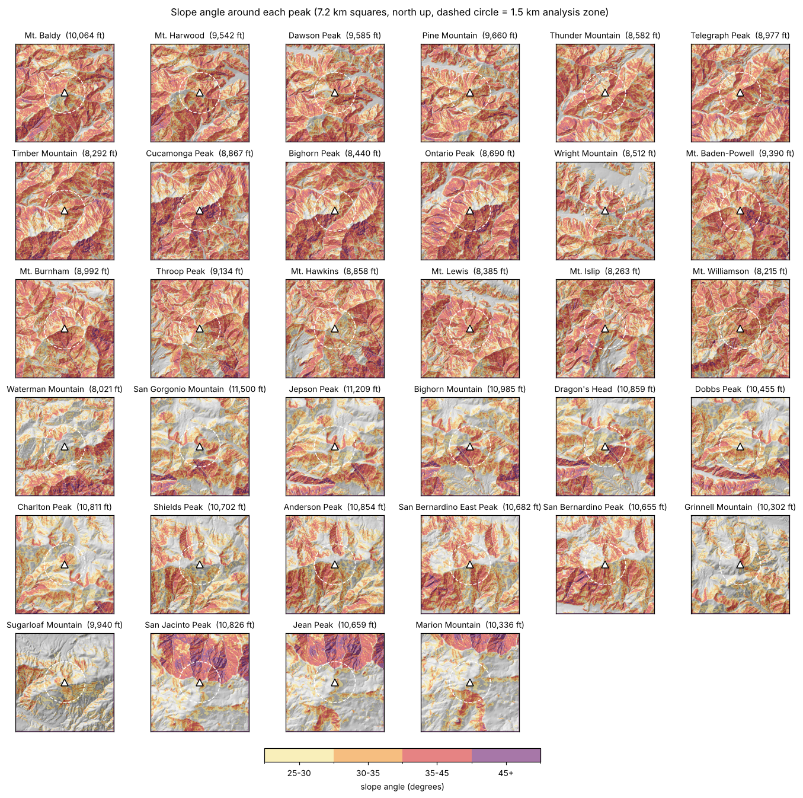
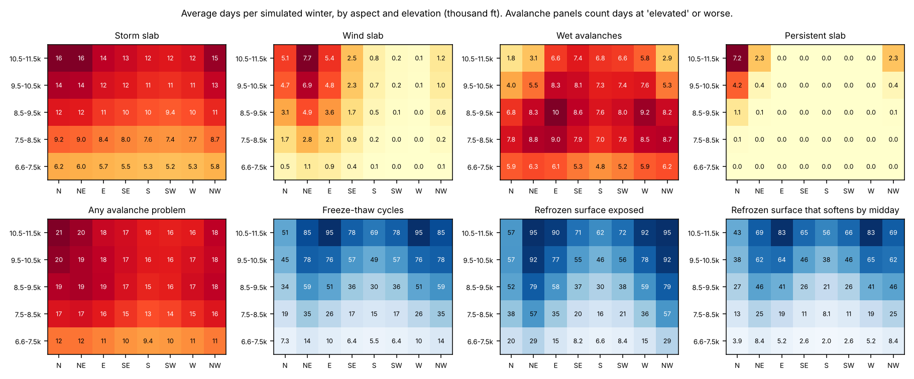
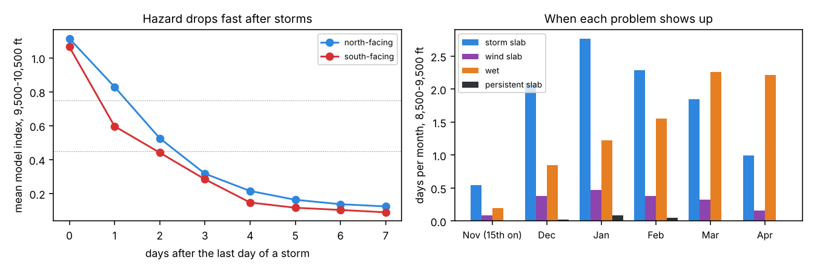
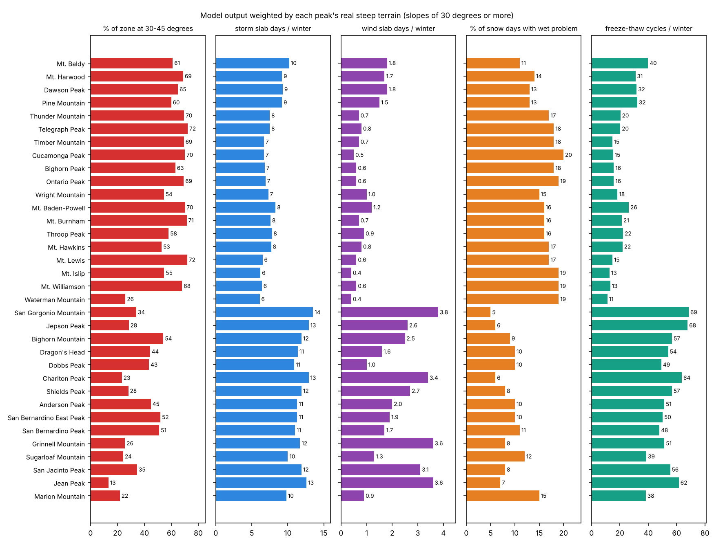
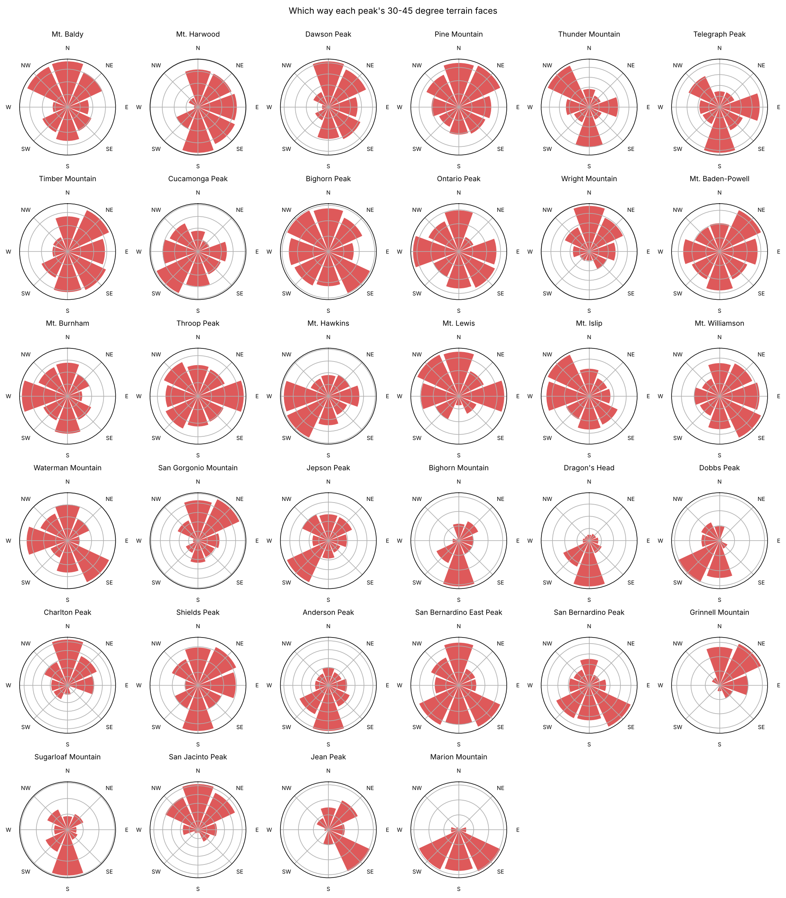
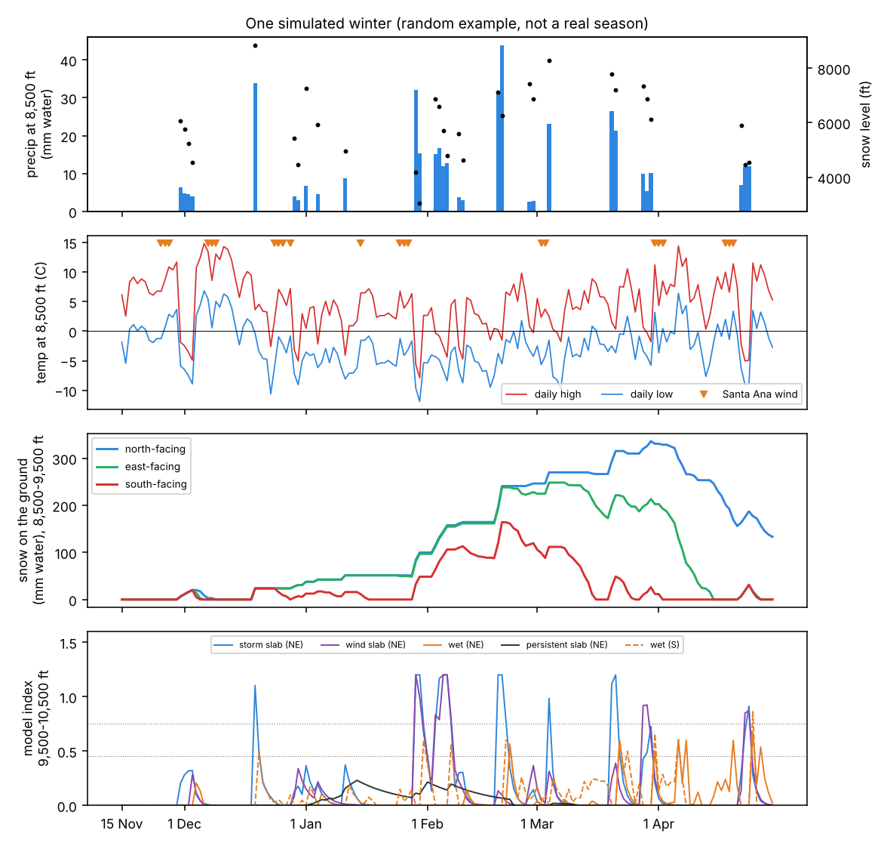

# socal-snowpack-sim

A terrain and snowpack simulator for Southern California ski-touring peaks.

It takes real elevation data for 34 peaks in the San Gabriel, San Bernardino and San Jacinto
mountains, works out how steep each one is and which way it faces, and then runs 400
randomly generated SoCal winters through a simple snowpack model to see which avalanche problems
show up on which aspects and elevations, and for how long.

> **This is not an avalanche forecast.** The weather is simulated, the snowpack rules are
> hand-tuned, and nothing here has been validated against field data. It shows patterns to
> learn from. It cannot tell you whether a slope is safe. See [DISCLAIMER.md](DISCLAIMER.md).

To look around instead of reading, open the 3D viewer at
[londo.me/socal-snowpack-sim](https://londo.me/socal-snowpack-sim/). Pick a peak, switch between
painted relief, satellite, USGS topo, lidar hillshade, slope and aspect, and play a dry, typical or
big simulated winter day by day on the real terrain.



## Why

SoCal has steep terrain, a strange snowpack and no government avalanche forecast centre. The
usual line is "it all gets baked, so it's stable". The record says otherwise: avalanches have
buried Mt. Baldy Road (2023), caught hikers in Baldy Bowl (2017, 2021) and killed three people
outside Mountain High in one day (2008). This project is an attempt to reason about where and
when the problems are likely, starting from the terrain.

## What it found

These are model results. Read the limits section before trusting any of them.

**Terrain (real data)**

- The San Gabriel peaks are steep almost everywhere. Around Baldy, Telegraph, Cucamonga, Ontario
  and Baden-Powell, 60 to 72% of the ground near the summit is between 30 and 45 degrees.
- The San Gorgonio and San Jacinto high country is gentler overall (roughly 13 to 54% in that
  range) but higher, so it holds snow much longer.
- Aspect varies a lot peak to peak. Grinnell, Charlton, San Jacinto, San Gorgonio and Wright put
  more than half of their steep terrain on N, NE and E slopes, which are lee to typical storm
  winds. Dobbs, Dragon's Head, Marion and Cucamonga are mostly sun-facing.

**Simulated snowpack**

- **Storm slab is the main avalanche problem on every aspect.** About 12 days a winter at
  8,500-9,500 ft, 16 at 10,500-11,500 ft.
- **Danger spikes in storms and fades in days.** Averaged over storms, the index at 9,500-10,500 ft
  on north slopes is 1.1 on the last storm day, 0.53 two days later and 0.32 after three
  (0.45 is my "elevated" line).
- **Wind slab concentrates on N, NE and E slopes up high.** About 8 days a winter on NE slopes
  at 10,500-11,500 ft versus 0.2 on SW.
- **Sun-facing slopes are wet far more of the time they hold snow.** At 7,500-8,500 ft a south slope
  has a wet problem on 27% of its snow-covered days, a north slope on 9%.
- **Persistent slab is rare and lives on high, shaded slopes.** The model only produces it on
  N, NE and NW aspects above about 8,500 ft, up to 7 days a winter at the top. It probably
  undercounts it.
- **Winters vary enormously.** Days with any elevated problem at 8,500-9,500 ft range from 2
  (dry year) to 52 (big year), median 26.



### The freeze-thaw cycle

SoCal's defining feature is the daily melt and refreeze. The model tracks it explicitly: a
cycle is a day when the surface thaws (sun or warm air) and the night drops below freezing.

- At 8,500-9,500 ft, a south slope goes through a cycle on 72% of its snow-covered days, an
  east slope on 73%, a north slope on 33%.
- Each cycle builds crust. In the model that does four things:
  1. **Ice.** A refrozen surface with no new snow on it is the slide-for-life hazard behind
     many winter deaths on Baldy. It is the normal condition between storms.
  2. **Bad bonding.** The next storm lands on a slick crust, which raises the storm-slab index.
  3. **Facets at the crust.** Thin, cold, dry snow over a buried crust grows weak grains. A
     rescuer described exactly this layering at the 2008 Mountain High accidents.
  4. **Corn.** After several cycles the snow is coarse and drains well, so the same melt gives
     less wet-avalanche hazard, unless nights stop freezing. Then it gets worse fast.
- Timing follows from this. Early, a refrozen slope is ice. Late on a sunny day, it is wet
  slides and rockfall. The usable window in between moves with aspect and season.



## Peak by peak

Day counts are the model's aspect-by-elevation table averaged over each peak's real steep
terrain (slopes of 30 degrees or more within 1.5 km of the summit and no more than 750 m below
it). "N+NE+E share" is how much of the 30-45 degree terrain faces those lee aspects. Zones of
neighbouring peaks overlap.

### Baldy area

| Peak | Summit (ft) | 30-45 deg | Steep terrain mostly faces | N+NE+E share | Storm slab days | Wind slab days | Wet (% of snow days) | Persistent days | Freeze-thaw cycles | Snow-cover days |
|---|---|---|---|---|---|---|---|---|---|---|
| Mt. Baldy (San Antonio) | 10,064 | 61% | N | 42% | 10 | 1.8 | 11% | 0.2 | 40 | 71 |
| Mt. Harwood | 9,542 | 69% | S | 48% | 9 | 1.7 | 14% | 0.1 | 31 | 57 |
| Dawson Peak | 9,585 | 65% | N | 53% | 9 | 1.8 | 13% | 0.1 | 32 | 62 |
| Pine Mountain | 9,660 | 60% | NE | 46% | 9 | 1.5 | 13% | 0.1 | 32 | 62 |
| Thunder Mountain | 8,582 | 70% | NW | 30% | 8 | 0.7 | 17% | 0.0 | 20 | 43 |
| Telegraph Peak | 8,977 | 72% | S | 33% | 8 | 0.8 | 18% | 0.0 | 20 | 42 |
| Timber Mountain | 8,292 | 69% | NE | 45% | 7 | 0.7 | 18% | 0.0 | 15 | 36 |

### Cucamonga / Icehouse

| Peak | Summit (ft) | 30-45 deg | Steep terrain mostly faces | N+NE+E share | Storm slab days | Wind slab days | Wet (% of snow days) | Persistent days | Freeze-thaw cycles | Snow-cover days |
|---|---|---|---|---|---|---|---|---|---|---|
| Cucamonga Peak | 8,867 | 70% | SW | 26% | 7 | 0.5 | 20% | 0.0 | 15 | 34 |
| Bighorn Peak | 8,440 | 63% | SE | 34% | 7 | 0.6 | 18% | 0.0 | 16 | 38 |
| Ontario Peak | 8,690 | 69% | W | 34% | 7 | 0.6 | 19% | 0.0 | 16 | 37 |

### Wrightwood / Blue Ridge

| Peak | Summit (ft) | 30-45 deg | Steep terrain mostly faces | N+NE+E share | Storm slab days | Wind slab days | Wet (% of snow days) | Persistent days | Freeze-thaw cycles | Snow-cover days |
|---|---|---|---|---|---|---|---|---|---|---|
| Wright Mountain | 8,512 | 54% | N | 57% | 7 | 1.0 | 15% | 0.0 | 18 | 48 |

### Angeles Crest

| Peak | Summit (ft) | 30-45 deg | Steep terrain mostly faces | N+NE+E share | Storm slab days | Wind slab days | Wet (% of snow days) | Persistent days | Freeze-thaw cycles | Snow-cover days |
|---|---|---|---|---|---|---|---|---|---|---|
| Mt. Baden-Powell | 9,390 | 70% | NE | 41% | 8 | 1.2 | 16% | 0.0 | 26 | 50 |
| Mt. Burnham | 8,992 | 71% | W | 30% | 8 | 0.7 | 16% | 0.0 | 21 | 45 |
| Throop Peak | 9,134 | 58% | E | 39% | 8 | 0.9 | 16% | 0.0 | 22 | 46 |
| Mt. Hawkins | 8,858 | 53% | SW | 32% | 8 | 0.8 | 17% | 0.0 | 22 | 44 |
| Mt. Lewis | 8,385 | 72% | NW | 46% | 6 | 0.6 | 17% | 0.0 | 15 | 38 |
| Mt. Islip | 8,263 | 55% | NW | 28% | 6 | 0.4 | 19% | 0.0 | 13 | 33 |
| Mt. Williamson | 8,215 | 68% | SE | 43% | 6 | 0.6 | 19% | 0.0 | 13 | 34 |
| Waterman Mountain | 8,021 | 26% | SE | 30% | 6 | 0.4 | 19% | 0.0 | 11 | 32 |

### San Gorgonio Wilderness

| Peak | Summit (ft) | 30-45 deg | Steep terrain mostly faces | N+NE+E share | Storm slab days | Wind slab days | Wet (% of snow days) | Persistent days | Freeze-thaw cycles | Snow-cover days |
|---|---|---|---|---|---|---|---|---|---|---|
| San Gorgonio Mountain | 11,500 | 34% | NE | 57% | 14 | 3.8 | 5% | 1.7 | 69 | 99 |
| Jepson Peak | 11,209 | 28% | SW | 37% | 13 | 2.6 | 6% | 1.4 | 68 | 94 |
| Bighorn Mountain | 10,985 | 54% | S | 36% | 12 | 2.5 | 9% | 0.8 | 57 | 78 |
| Dragon's Head | 10,859 | 44% | S | 18% | 11 | 1.6 | 10% | 0.5 | 54 | 71 |
| Dobbs Peak | 10,455 | 43% | SW | 13% | 11 | 1.0 | 10% | 0.5 | 49 | 71 |
| Charlton Peak | 10,811 | 23% | N | 60% | 13 | 3.4 | 6% | 1.4 | 64 | 99 |
| Shields Peak | 10,702 | 28% | S | 46% | 12 | 2.7 | 8% | 0.6 | 57 | 84 |
| Anderson Peak | 10,854 | 45% | S | 28% | 11 | 2.0 | 10% | 0.5 | 51 | 73 |
| San Bernardino East Peak | 10,682 | 52% | SE | 30% | 11 | 1.9 | 10% | 0.6 | 50 | 76 |
| San Bernardino Peak | 10,655 | 51% | SE | 26% | 11 | 1.7 | 11% | 0.4 | 48 | 71 |
| Grinnell Mountain | 10,302 | 26% | NE | 79% | 12 | 3.6 | 8% | 0.6 | 51 | 89 |

### Big Bear

| Peak | Summit (ft) | 30-45 deg | Steep terrain mostly faces | N+NE+E share | Storm slab days | Wind slab days | Wet (% of snow days) | Persistent days | Freeze-thaw cycles | Snow-cover days |
|---|---|---|---|---|---|---|---|---|---|---|
| Sugarloaf Mountain | 9,940 | 24% | S | 26% | 10 | 1.3 | 12% | 0.2 | 39 | 62 |

### San Jacinto

| Peak | Summit (ft) | 30-45 deg | Steep terrain mostly faces | N+NE+E share | Storm slab days | Wind slab days | Wet (% of snow days) | Persistent days | Freeze-thaw cycles | Snow-cover days |
|---|---|---|---|---|---|---|---|---|---|---|
| San Jacinto Peak | 10,826 | 35% | N | 60% | 12 | 3.1 | 8% | 0.7 | 56 | 93 |
| Jean Peak | 10,659 | 13% | SE | 47% | 13 | 3.6 | 7% | 0.8 | 62 | 89 |
| Marion Mountain | 10,336 | 22% | SE | 5% | 10 | 0.9 | 15% | 0.0 | 38 | 52 |





Per-peak slope maps are in [figures/peaks](figures/peaks). Full numbers are in
[results/peaks.json](results/peaks.json) and [results/model.json](results/model.json).

## How it works

1. **Terrain** (`src/terrain.py`). Downloads public elevation tiles (AWS Terrain Tiles, built
   from USGS 3DEP, about 16 m per pixel), then computes slope and aspect. Each peak is snapped
   to the local high point and checked against its listed elevation; all 34 agree within 30 ft.
2. **Weather generator** (`src/model.py`). Random storms, mostly from the S to W, a quarter of
   them warm with high snow levels; Santa Ana wind events; sunny spells in between; large
   year-to-year swings. Daily step, 15 Nov to 30 Apr.
3. **Snowpack** (`src/model.py`). For 8 aspects and 5 elevation bands on a 38 degree slope it
   tracks new snow, wind loading on lee slopes, sun on each aspect from the sun's path at 34 N,
   melt, refreezing, melt-freeze cycles, and facet growth. It outputs an index from 0 to about
   1.2 for storm slab, wind slab, wet avalanches and persistent slab. 0.45 is "elevated" and
   0.75 is "high". Those cut-offs are the author's.
4. **Analysis** (`src/analyze.py`). Weights the model table by each peak's terrain and draws
   the figures.



## Reality check

Not validation, just a comparison with what has been written about these mountains:

| Documented | Model |
|---|---|
| Baldy Bowl is sun-facing, with wet slides and rockfall on sunny days | Bowl terrain faces SE to SW; those aspects carry the highest wet share |
| Cold slabs release after storms off the Bowl's NE-facing, wind-loaded ridge | Wind slab concentrates on N to E aspects near ridgelines |
| SoCal danger spikes in storms and drops quickly afterwards | Index falls below "elevated" about two to three days after a storm |
| 2008 Mountain High accidents: crust, facets, then a cold storm, high danger on N-facing slopes | Persistent problem appears only on shaded high slopes; crust-facet process included |
| Hard ice and long sliding falls are the main killer on Baldy | Refrozen surface is exposed on most snow-covered days between storms |

Some of this agreement is built in by the rules, so treat it as a consistency check.

## Limits

- **The weather is made up.** It is not fitted to station records. The same weather is applied
  to every range, although San Gorgonio and San Jacinto have their own climates.
- **It runs snowy.** Median simulated snowfall at 7,500-8,500 ft is about 78 inches a winter (range
  12 to 206). Mt. Baldy resort's reported average is 39 inches, with single winters
  from 6 to 106. Read the day counts as leaning high.
- **All thresholds and rates are hand-set.** The aspect and timing patterns are sturdier than
  the day counts.
- **One slope angle, daily time step.** No terrain shading, trees, gully cross-loading,
  cornices or rockfall. It cannot see a slope that is safe at 8 am and dangerous at noon.
- **The grid smooths the steepest pitches.** Headwalls and chutes are steeper than they map.
- **The ice flag is crude.** It misses wind-scoured faces that are hard without ever melting.

## Run it

```
pip install -r requirements.txt
python src/terrain.py     # downloads elevation tiles into data/
python src/model.py       # 400 simulated winters, about 20 seconds
python src/analyze.py     # figures/ and results/
```

Add a peak by adding a line to `src/peaks.py`. `terrain.py` will flag it if the coordinates
don't land on a summit of the listed height.

### The 3D viewer

The viewer lives in `site/` (Vite and three.js). Its data in `site/public/data/` is committed, so
you only need Node to work on the page:

```
cd site
npm install
npm run dev               # http://localhost:5173/socal-snowpack-sim/
```

After changing the model or the peak list, rebuild that data with
`python src/export_site.py` (after the three steps above). It writes finer elevation grids, pulls
a lidar hillshade for each peak from the USGS 3DEP service (slow the first time, cached in
`data/lidar/`), and re-runs the dry, typical and big winters with the same seed as `model.py`.
Satellite and topo layers load live from the USGS National Map.

Pushes to `main` that touch `site/` deploy it to GitHub Pages.

## Where this could go

The obvious next step is to drive the snowpack model with real weather instead of simulated
weather. Before anything like that is shown to the public it needs, at minimum:

- real station and gridded weather for each range, with snow level handled carefully;
- validation against snow-pit and avalanche observations over several winters;
- input from the So Cal Snow Avalanche Center and local forecasters and guides;
- output framed as conditions and patterns, not danger ratings, with uncertainty shown.

## Data and credits

- Elevation: [Terrain Tiles on AWS Open Data](https://registry.opendata.aws/terrain-tiles/)
  (USGS 3DEP in the US).
- Peak coordinates and elevations cross-checked against the Sierra Club Hundred Peaks Section
  list.
- Accident and conditions history: SierraDescents, SnowBrains, Los Angeles Times, LAist,
  NBC Los Angeles, SummitPost, The Snowy Torrents.
- Snowfall comparison: OnTheSnow.
- Viewer: lidar hillshade from the USGS 3DEP elevation service, satellite and topo from the
  USGS National Map (public domain); built with three.js and Vite (MIT) and set in Barlow
  (SIL Open Font License).

MIT licensed. See [LICENSE](LICENSE).
